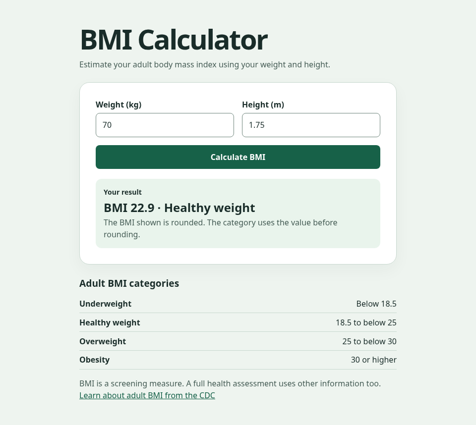

# BMI Calculator

Individual final project for CMPS 510 – Principles and Concepts of Software Engineering.

The calculator estimates adult body mass index (BMI) from weight in kilograms and height in meters. It shows the BMI and its category, and explains how to correct invalid measurements. The page works on desktop and mobile screens. It runs in the browser and does not store measurements.

## Run it locally

1. If your browser allows local files, open `index.html`. In a managed browser, run this command from the project folder and open `http://127.0.0.1:8000/`:

   ```sh
   python3 -m http.server 8000 --bind 127.0.0.1
   ```
2. Enter **70 kg** and **1.75 m**. Select **Calculate BMI** to see **22.9 · Healthy weight**.
3. Change the height to **0** and select **Calculate BMI** again to see the validation message.



## Project materials

- [Short report (PDF)](docs/bmi-report.pdf)
- [Rubric checklist](docs/rubric-checklist.md)
- [Presentation and GitHub Pages guide](docs/presentation-and-publishing.md)

## Tools and sources

- HTML, CSS, and JavaScript build the page. The app uses no external libraries.
- Chromium and Playwright were used for local browser checks. ReportLab was used to make the PDF.
- OpenAI Codex helped build, test, and document the project.
- The adult category thresholds come from the [CDC Adult BMI Calculator](https://www.cdc.gov/bmi/adult-calculator/).
